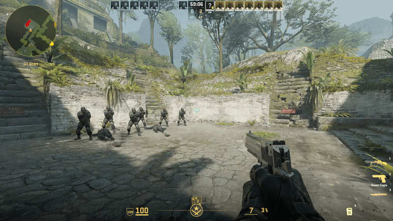
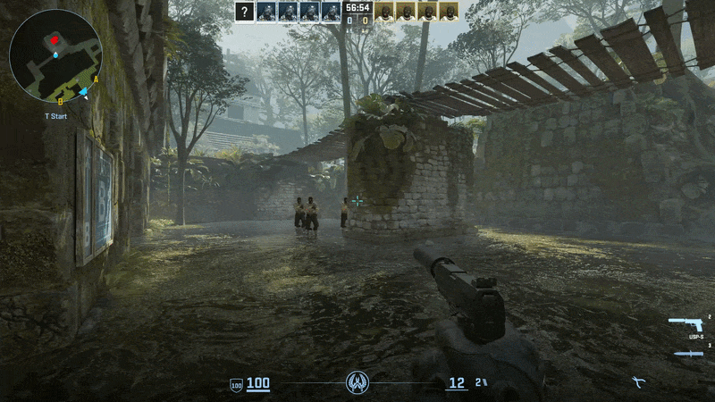
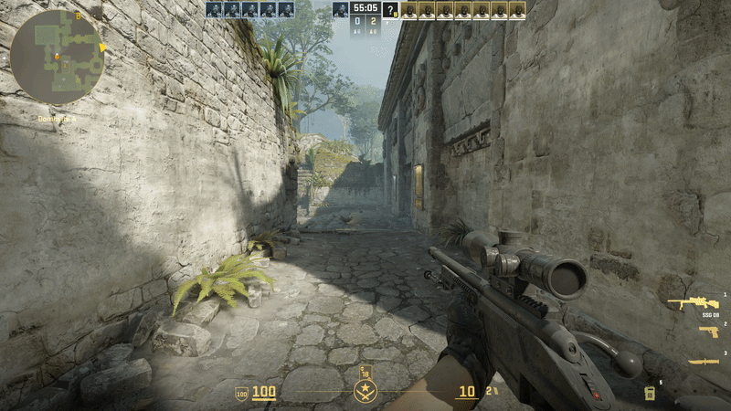
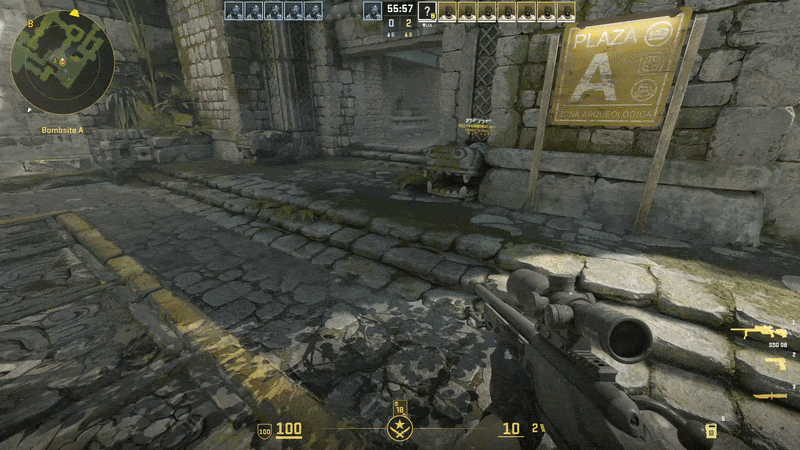
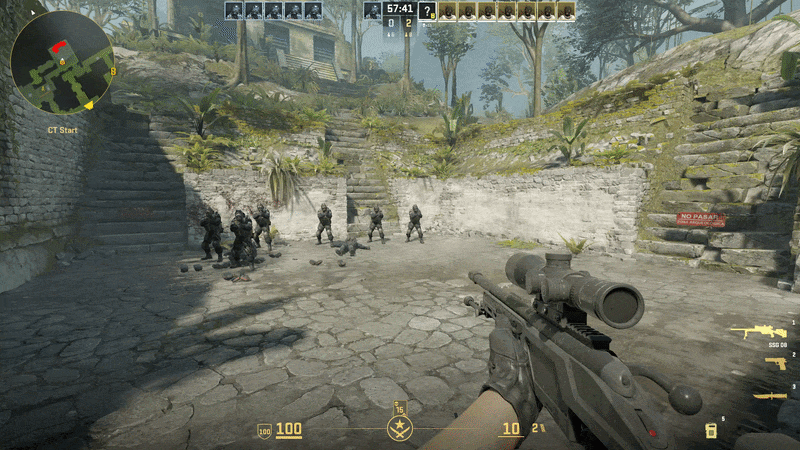
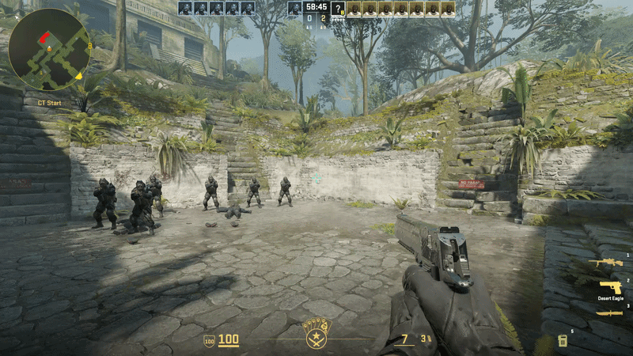

# AntiCheat

<div align="center">


AntiCheat watches the aim, shots, movement, button presses, and game settings that players send to the server. When it finds enough strong evidence, it reports the player and can ask the server to punish them.

</div>

## Showcase

<table>
<tr>
<td width="50%" align="center">

<br><strong>AIMBOT</strong><br>
<sub>A damaging shot follows a blatant snap onto the target.</sub>
</td>
<td width="50%" align="center">

<br><strong>AIMLOCK</strong><br>
<sub>The aim follows a moving enemy with machine-like precision.</sub>
</td>
</tr>
<tr>
<td width="50%" align="center">

<br><strong>ANTIAIM</strong><br>
<sub>The view produces impossible angles, spin, jitter, or attack-return patterns.</sub>
</td>
<td width="50%" align="center">

<br><strong>BHOP</strong><br>
<sub>Landings and jump inputs repeat with automated timing.</sub>
</td>
</tr>
<tr>
<td width="50%" align="center">

<br><strong>IRREGULAR BEHAVIOR</strong><br>
<sub>Rage-level airborne and no-scope results keep adding up.</sub>
</td>
<td width="50%" align="center">

<br><strong>SILENTAIM</strong><br>
<sub>The damaging firing angle does not follow the visible aim path.</sub>
</td>
</tr>
</table>

## Version 1.0.1

This release fixes Windows and Linux builds against the CS2 SDK by linking the SDK's KeyValues3 and EntityKeyValues implementations. GameEntitySystem access now uses the SDK-provided accessor instead of a gamedata offset.

Windows x64 was built with MSVC 19.51, and Linux x64 was built with Clang in the pinned Steam Runtime 3 SDK image, using CS2 SDK commit `a508eb5ed5fb36f4067fa36a1c33f5fec7d73066` and MetaMod:Source commit `ea513d8960c52d266a1c5620dc762def0dd8bce8`. The plugin remains a native MetaMod:Source plugin and does not require CounterStrikeSharp; it is intended to run alongside CounterStrikeSharp 1.0.380. Runtime loading and gamedata signatures/offsets still require verification against the target CS2 server binaries.

## Quickstart

You need a Windows x64 or Linux x64 CS2 dedicated server running [Metamod:Source](https://www.sourcemm.net/) 2.x.

1. Open this repository's **Releases** tab and choose the matching Windows or Linux package.
2. Extract it into the CS2 server root without rearranging anything. The package begins with the `game` folder.
3. Edit `game/csgo/cfg/AntiCheat.cfg`.
4. Start the server.
5. Run `meta list`, then `AntiCheat_status`.

That is it. Players install nothing.

The default punishment commands are made for [CS2-SimpleAdmin](https://github.com/daffyyyy/CS2-SimpleAdmin). If your server uses another admin plugin, replace the two commands in `AntiCheat.cfg` with commands that plugin understands.

## Administrator and server-console commands

Run these commands from the dedicated-server console or through RCON. `AntiCheat_help` prints the built-in command list.

| Command | What it does |
| --- | --- |
| `AntiCheat_status` | Show plugin status, connected-player counts, enabled detectors, announcements, punishments, and webhook state. |
| `AntiCheat_help` | Print the administrator command list. |
| `AntiCheat_reload` | Reload and validate `AntiCheat.cfg`; clears transient detector evidence after the reload completes. |
| `AntiCheat_check_config` | Check current settings and report configuration problems without changing them. |
| `AntiCheat_test_announcement` | Send a harmless chat and center-screen announcement test. |
| `AntiCheat_webhook_test` | Send a harmless test report to configured Discord and JSON webhooks. |

## Detection output

When a detector finds enough evidence, AntiCheat can report the result wherever the server owner needs it:

1. Announce it in public chat.
2. Hold a center-screen alert for three seconds.
3. Write the detector evidence to the server console.
4. Submit the configured ban or kick command to the server.
5. Send a detailed Discord webhook report.

Chat and center-screen announcements can be turned on or off separately. AntiCheat sends the chosen ban or kick command to the server. The installed admin plugin must understand and run that command.

```text
[AntiCheat] detected AIMBOT on Player and punished.
```

Whitelisted players can still be detected and reported, but AntiCheat stops before submitting a punishment command. Disabled output channels stay quiet.

## Detection modules

All 18 modules are enabled by default, and each one can be turned off. Open **How strict is it?** to see its main rule. These numbers come from the current code and cannot be changed in the config.

### Aim and accuracy

**Aimbot.** An aimbot can quickly move the crosshair onto an enemy just before it shoots. AntiCheat checks where the player was aiming before and after a damaging shot, and how close the snap moved to the enemy.

<details>
<summary><strong>How strict is it?</strong></summary>

Any three suspicious one-command snaps, snap-returns, or matching smooth aim curves before damaging shots, in any combination within five minutes. The enemy must be at least 100 game units away, and AntiCheat checks the half-second before the shot.

</details>

**Aimlock.** An aimlock keeps the crosshair stuck to a moving enemy. AntiCheat checks whether the crosshair stays inside a small area around the same enemy while they move, even behind a wall.

<details>
<summary><strong>How strict is it?</strong></summary>

This must happen three times within five minutes. Each time, the lock must last two seconds, stay on the enemy for at least 95% of that time, follow at least 128 game units of movement, and start at least 200 game units away.

</details>

**Triggerbot.** A triggerbot fires when the crosshair first touches an enemy. AntiCheat casts the same kind of first-hit ray through the current server hitboxes and remembers the player's last 30 damaging fresh-contact shots, whether the aim moved onto the enemy or the enemy entered a held angle.

<details>
<summary><strong>How strict is it?</strong></summary>

The previous contact with that enemy must be at least one second old, and the confirmed shot must damage that same enemy. Contact-to-damage shots in 0-1 ticks add 2 points; reactions of 2 ticks or longer remove 3 points. Detection needs 10 points and the score cannot fall below zero. Walls, misses, held sprays, unconfirmed shots, unsafe networking, possible smoke, the R8 Revolver, and the Zeus cannot change the score.

</details>

**Silentaim.** Silent aim can send a damaging shot in another direction without moving the player's visible aim there. AntiCheat checks where the player looked just before, during, and after the shot. It also allows for the weapon's normal accuracy and bullet spread.

<details>
<summary><strong>How strict is it?</strong></summary>

The detector needs 10 points within five minutes. A suspicious hit adds 2 points on the ground, 3 in the air, or 4 when it is more than 22.5 degrees past the weapon's normal limit. A headshot adds 1 more, a hit through a wall or smoke adds 2 more, and a no-scope adds 1 more. A normal hit removes 2 points.

</details>

**Inhuman Accuracy.** Nospread and rage cheats can keep hitting far more shots than a normal player. AntiCheat counts only shots fired while the crosshair is already close to a real enemy, then checks how many of those shots deal damage.

<details>
<summary><strong>How strict is it?</strong></summary>

At least 40 counted shots within five minutes. The enemy must be at least 100 game units away, and at least 90% of the shots must hit.

</details>

**Irregular Behavior.** Rage cheats can turn jump shots and no-scope sniper shots into easy kills. AntiCheat counts both hits and misses. Harder kills, such as long-range headshots and wallbangs, give more points.

<details>
<summary><strong>How strict is it?</strong></summary>

The detector needs 16 points within five minutes. It also needs at least three hard kills from at least four attempts, with a success rate of 50% or more. Kills below 10 metres do not count as successful hard kills.

</details>

### Movement

**Autostrafe.** An autostrafe cheat moves the player left and right in the air to gain or keep speed. AntiCheat compares the turns, speed, and timing across many jumps.

<details>
<summary><strong>How strict is it?</strong></summary>

The detector needs 15 suspicious jumps in the latest 20. It can detect after five suspicious jumps when at least one has more than 30 strafes per second. It can also detect when more than 90% of recent air turns follow the same perfect pattern.

</details>

**Bhop.** A bhop cheat presses jump at the exact moment the player lands, again and again. AntiCheat checks the landing time and repeated jump-button patterns. Failed jumps make the evidence weaker.

<details>
<summary><strong>How strict is it?</strong></summary>

AntiCheat starts checking after at least 20 landings. It needs either 10 perfect jumps in a row, or a score of 7 where at least 90% of seven or more jump patterns repeat the same short input pattern.

</details>

**Hyperscroll.** Hyperscroll sends a very large number of jump presses around each landing. AntiCheat checks how many presses were sent and how often they still produced a perfect jump.

<details>
<summary><strong>How strict is it?</strong></summary>

The detector needs at least 20 jump patterns and 20 checked landings. They must average at least 16 jump presses, and more than 60% of the landings must be perfect jumps.

</details>

**Nulls.** A nulls script changes between opposite movement keys, such as A and D, with perfect timing in the air. AntiCheat checks when one key is released, when the other is pressed, the player's air speed, and their frame rate.

<details>
<summary><strong>How strict is it?</strong></summary>

The detector needs at least 128 key changes and a perfect-timing score between 128 and 640 while the player moves at least 100 game units per second in the air. A lower frame rate or a normal delay between the two keys makes the detector require more evidence.

</details>

### Client behavior

**Antiaim.** Anti-aim sends view angles that normal play should not create. It can make the player look in an impossible direction, spin, repeat the same shaking pattern, or quickly turn away and back while shooting. AntiCheat gives these actions points, and the points fall over time when the behavior stops.

<details>
<summary><strong>How strict is it?</strong></summary>

The detector needs 100 points. It can also detect a steady spin of 320–999 degrees per second after 15 seconds, a steady spin of 1,000 degrees per second or more after 10 seconds, or the same shaking pattern repeating for 10 seconds.

</details>

**DLL Injection.** Some injected cheats ask the game to send them events that a normal client does not usually need. The server can see this event list, so AntiCheat compares it with a list of suspicious events.

<details>
<summary><strong>How strict is it?</strong></summary>

One match from the 117 checked events is enough. The first check runs 10 seconds after the player joins, and the next checks run every two minutes.

</details>

This detector does not scan the player's files or computer memory. It cannot find every kind of DLL injection. It only reports this one behavior that the server can see.

**Desubticking.** CS2 normally records the small time between movement changes inside each server update. Some cheats remove that time and set it to zero. AntiCheat checks how often this happens.

<details>
<summary><strong>How strict is it?</strong></summary>

The detector needs at least 30 movement commands within 20 seconds. At least 90% of them must have their small timing value set to zero. AntiCheat ignores the first 10 seconds after the player joins.

</details>

**Doubletap.** A doubletap cheat makes the same gun fire twice almost at once. AntiCheat looks for the same gun firing twice during the same server update or the next one. It also checks the player's connection before sending a punishment.

<details>
<summary><strong>How strict is it?</strong></summary>

The detector needs two fast-fire pairs. A bad connection does not hide the alert, but AntiCheat will not send the punishment command.

</details>

**Invalid CVar.** A CVar is simply a game setting. AntiCheat asks the player's game for important settings and checks whether the values are normal. This can find protected settings that were changed or values that should not be possible.

<details>
<summary><strong>How strict is it?</strong></summary>

One invalid setting is enough. AntiCheat reports it once and stays quiet until that setting becomes normal again.

</details>

**Invalid Input.** Every movement command tells the server which buttons are held and which buttons were pressed or released. AntiCheat checks whether those two parts agree. Cheats can create commands where they do not.

<details>
<summary><strong>How strict is it?</strong></summary>

The detector needs eight broken commands within five seconds.

</details>

**Namechanger.** A namechanger cheat quickly changes the player's visible name to create spam or confusion. AntiCheat counts the name changes for each player separately.

<details>
<summary><strong>How strict is it?</strong></summary>

The detector needs five visible name changes within one minute.

</details>

**Subtick Spam.** This cheat sends many movement or aim changes at exactly the same moment inside one server update. AntiCheat counts commands that repeat this unusual pattern.

<details>
<summary><strong>How strict is it?</strong></summary>

The detector needs 20 suspicious commands within half a second.

</details>

## Configuration

<details>
<summary><strong>Configuration reference</strong></summary>

The included [`AntiCheat.cfg`](cfg/AntiCheat.cfg) explains every option in plain language.

| Setting | Default | What it does |
| --- | ---: | --- |
| `AntiCheat_enabled` | `1` | Master switch for AntiCheat. |
| `AntiCheat_whitelist` | empty | SteamID64s that may be detected but must never be punished. |
| `AntiCheat_*_enabled` | `1` | Enable or disable one detection module. |
| `AntiCheat_chat_announcements` | `1` | Show detections in public chat. |
| `AntiCheat_center_announcements` | `1` | Show the three-second center alert. |
| `AntiCheat_language` | `en` | Language used for public messages and Discord reports. |
| `AntiCheat_punishment_command` | `css_addban ...` | Command submitted for permanent-ban detections. |
| `AntiCheat_kick_command` | `css_kick ...` | Command submitted for kick-only detections. |
| `AntiCheat_webhook_url` | empty | Discord webhook that receives detection reports. |
| `AntiCheat_json_webhook_url` | empty | Optional HTTPS endpoint that receives neutral JSON detection reports. |
| `AntiCheat_json_webhook_bearer_token` | empty | Optional bearer token sent to the JSON endpoint. |
| `AntiCheat_webhook_role_id` | empty | Discord role to mention on a report. |
| `AntiCheat_webhook_server_address` | automatic | Server address shown in Discord. |
| `AntiCheat_webhook_logo_url` | empty | Optional public HTTPS image for Discord report branding. |
| `AntiCheat_allow_sv_cheats_testing` | `0` | Allow local detector testing with `sv_cheats 1`. Never enable this on a public server. |

Punishment commands support `{steamid64}`, `{userid}`, and `{detection}`:

```cfg
AntiCheat_punishment_command "css_addban {steamid64} 0 AntiCheat: {detection}"
AntiCheat_kick_command "css_kick #{userid} AntiCheat: {detection}"
```

Whitelist one account or a comma-separated list:

```cfg
AntiCheat_whitelist "76561198000000001,76561198000000002"
```

Set `AntiCheat_language` to one of the bundled language codes, then run `AntiCheat_reload`:

`ar`, `bg`, `cs`, `da`, `de`, `el`, `en`, `es-419`, `es-es`, `et`, `fi`, `fr`, `he`, `hr`, `hu`, `id`, `it`, `ja`, `ko`, `lt`, `lv`, `nl`, `no`, `pl`, `pt-br`, `pt-pt`, `ro`, `ru`, `sk`, `sr`, `sv`, `th`, `tr`, `uk`, `vi`, `zh-cn`, `zh-tw`.

</details>

<details>
<summary><strong>Discord webhooks</strong></summary>

1. Create a webhook in the Discord channel that should receive detections.
2. Put its URL in `AntiCheat_webhook_url`.
3. Run `AntiCheat_reload`.
4. Run `AntiCheat_webhook_test`.

Keep the webhook URL private. AntiCheat never prints it back to the console.

</details>

<details>
<summary><strong>Generic JSON webhooks</strong></summary>

1. Put your HTTPS endpoint in `AntiCheat_json_webhook_url`.
2. Optionally set `AntiCheat_json_webhook_bearer_token` to send it in the `Authorization` header.
3. Run `AntiCheat_reload`.
4. Run `AntiCheat_webhook_test` to send a harmless test event.

AntiCheat can send to Discord and the JSON endpoint at the same time. JSON reports are sent in the background, retry temporary failures once, and treat any HTTP `2xx` response as success. Responses from the endpoint are never executed as commands; punishment remains controlled locally by AntiCheat.

Each event contains `type`, `version`, `steamid64`, `player`, `detection`, `evidence`, `outcome`, `map`, `server`, `server_address`, `timestamp`, and `plugin_version`.

</details>

Both scripts make a directly installable package under the build folder's `package/game` directory. Linux builds inside the pinned Steam Runtime 3 SDK image.

</details>

## Licensing

Keep the included copyright notices and license texts when redistributing this project. The root [`LICENSE`](LICENSE) contains GNU GPL version 3 text, while the plugin metadata declares AGPL-3.0 and the project includes AGPL-licensed code. Confirm the applicable project license before publishing a release; see [`COPYRIGHT.md`](COPYRIGHT.md) and [`THIRD_PARTY_NOTICES.md`](THIRD_PARTY_NOTICES.md).
